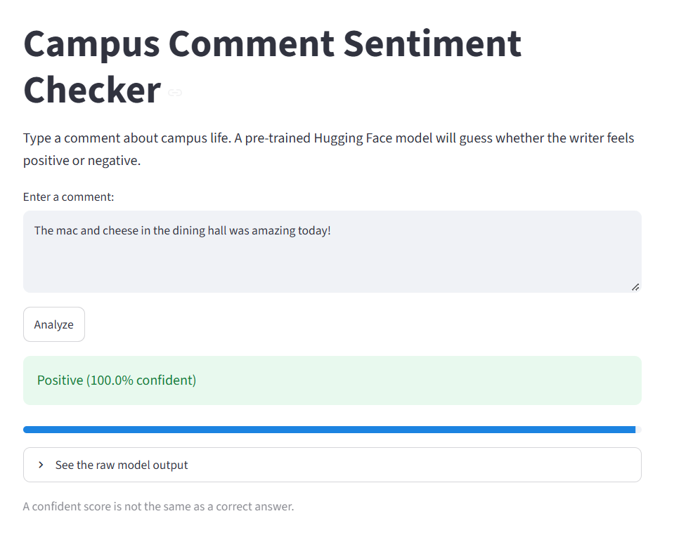

# hugging_face
Holds Advanced Programming resources for Hugging Face (Examples, Tutorials)
<ul>
  <li></li>
</ul>

To create the streamlit app, you can run it locally with VS Code or use your streamlit account to build and launch the app.

Try out the app here: <a href="https://cis3400-huggingface.streamlit.app/">CIS 3400 Hugging Face Sentiment Analysis App</a>

